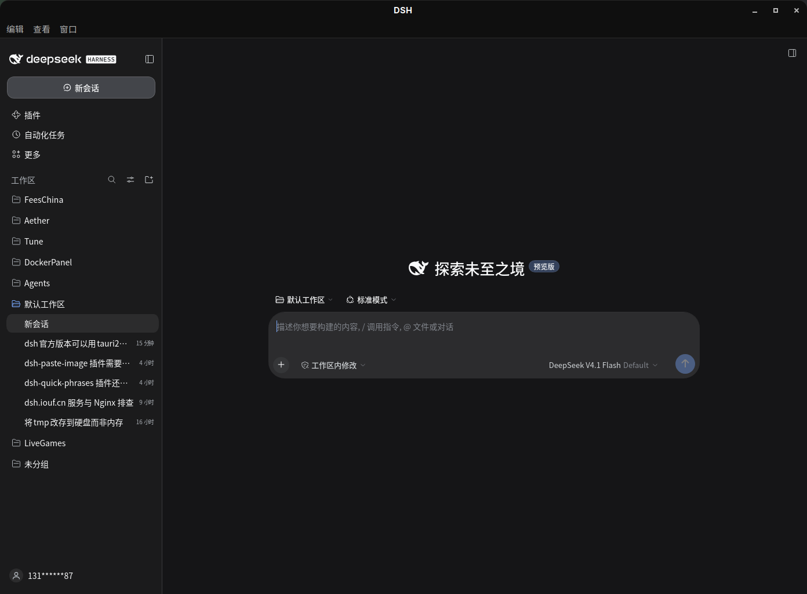

# dsh-tauri

[简体中文](docs/DETAIL.zh.md) · [English](docs/DETAIL.en.md) · [Español](docs/DETAIL.es.md) · [Français](docs/DETAIL.fr.md) · [Deutsch](docs/DETAIL.de.md) · [Русский](docs/DETAIL.ru.md) · [Português](docs/DETAIL.pt.md)

用 **Tauri 2** 给 [DeepSeek Harness](https://github.com/deepseek-ai) 做的桌面客户端：
窗口、托盘、菜单和原生能力来自 Rust + 系统 WebView，Harness 本身运行官方 npm 包
`@deepseek-ai/dsh`，也就是 `dsh web` 那套纯 Node 服务。

**不需要 Electron，也不需要安装 DSH Desktop。** 一个 `node` 加一份
`node_modules/@deepseek-ai/dsh` 就是全部运行时。

## 核心目标

**目标层**：本项目以 Linux 为第一优先、深度支持——优先支持各种发行版与不同版本，在兼容性、运行性能与资源消耗上尽量做到最好，Linux 是唯一完成适配与验证的平台；Windows / macOS 提供桌面端基础支持——能构建、能运行即可，不做深入适配与优化，建议直接从官方渠道下载 DeepSeek Harness 官方桌面版本，本项目的 Tauri 壳不作为 Win/Mac 用户的首选方案；移动端（iOS / Android）不支持——架构上依赖本地 Node 服务 + 系统 WebView，移动端沙箱与后台限制不适用。

> **现状层（如实说明）**：Linux 是唯一完成适配与验证的平台（当前代码依赖 GTK3 原生对话框与 Linux 原生命令 `zenity` / `wl-clipboard` / `notify-send`，且只在 Linux + WebKitGTK 2.52 上验证过；多发行版兼容仍是目标，不代表已全面验证）。Windows / macOS 提供基础支持、能构建能运行，但不做深入适配与优化，未做全面验证；移动端（iOS / Android）明确不支持，原因是架构上依赖本地 Node 服务 + 系统 WebView，移动端沙箱与后台限制不适用。



## 和「把 Electron 应用塞进 Tauri」有什么不同

Tauri 只提供系统 WebView 和 Rust 后端，不带 Node 运行时。所以关键不在于换个壳，
而在于**跑哪个本体**：

| 做法 | 运行时 | 结果 |
| --- | --- | --- |
| Tauri 套 Electron 安装目录 | `/opt/DSH NEXT` 的 app.asar（内核依赖 Electron 主进程） | 仍然要对官方安装做逆向，官方一升级就崩 |
| **本项目** | npm 上的 `@deepseek-ai/dsh`，`dsh web` 一个普通 Node 进程 | 本体是公开分发的包，升级只需改版本号 |

于是外壳要做的事只剩三件：把服务拉起来、把窗口指过去、把浏览器给不了的能力补上。

## 架构

```
┌────────────────────── Tauri 进程（Rust） ──────────────────────┐
│ 托盘 / 菜单 / 窗口状态 / 单实例 / 崩溃重启                      │
│ 原生命令：目录选择、剪贴板、通知、外链、窗口标题                │
│ window ──► http://127.0.0.1:<port>/?token=…                    │
└──────────┬───────────────────────────────────────▲─────────────┘
           │ spawn（stdout 里解析 URL）             │ invoke
┌──────────▼───────────────────────────────────────┴─────────────┐
│ node runtime/node_modules/@deepseek-ai/dsh/lib/bin.js           │
│   --profile web --host 127.0.0.1 --port 0 --no-open             │
│ 官方 Web UI + 插件 + 会话存储（DSH_HOME，默认 ~/.dsh）           │
└─────────────────────────────────────────────────────────────────┘
```

注入脚本（`src-tauri/src/native.rs::SHIM`）在页面脚本之前执行，补上
`__DSH_DIRECTORY_PICKER__`、`__DSH_TAURI__`（剪贴板/通知/外链），并把
`document.title` 同步到原生标题栏——WebKit 不会自己同步。

## 依赖

- Node 24+（在 PATH 里，或 `DSH_TAURI_NODE` 指定）
- **硬依赖（缺了起不来）**：Rust 1.9x、GTK3 / `webkit2gtk-4.1` / `libsoup-3.0` / `librsvg2` / `libayatana-appindicator3`（Tauri + WebKitGTK + 托盘决定，发行版包名见下表）、构建用 `patchelf`；关于面板与目录选择主路径都是外壳自绘 GTK3，不依赖外部对话框程序
- **可选增强（缺了对应功能降级）**：`wl-clipboard`（剪贴板）、`libnotify-bin`（`notify-send` 通知）、`xdg-utils`（`xdg-open` 外链）、`zenity` / `kdialog`（对话框兜底链 GTK → zenity → kdialog；KDE 系通常用 kdialog）
- Debian / Ubuntu 的 `.deb` 包已在 `bundle.linux.deb.depends` 中声明 `zenity`/`wl-clipboard`/`libnotify-bin`/`xdg-utils`，安装时一并拉取；AppImage 与源码运行需自行安装：

```bash
sudo apt install libwebkit2gtk-4.1-dev libsoup-3.0-dev librsvg2-dev \
  libayatana-appindicator3-dev patchelf build-essential \
  zenity kdialog wl-clipboard libnotify-bin xdg-utils
```

其他发行版包名（按包管理器分组；官方包名，KVM 实测结论见 [docs/COMPAT_MATRIX.md](docs/COMPAT_MATRIX.md)，未实测处会随实测更新）：

| 发行版 | 硬依赖（构建/运行库） | 可选增强（助手） |
| --- | --- | --- |
| Debian / Ubuntu（apt） | `libwebkit2gtk-4.1-dev libsoup-3.0-dev librsvg2-dev libayatana-appindicator3-dev` | `zenity kdialog wl-clipboard libnotify-bin xdg-utils` |
| Fedora（dnf，42 实测） | `webkit2gtk4.1-devel libsoup3-devel librsvg2-devel gtk3-devel`；AppImage 另需 `fribidi fontconfig libxcb mesa-libgbm libdrm mesa-libGL mesa-libEGL libX11`（实测装完 ldd 无 not found）。`libayatana-appindicator3(-devel)` 在 Fedora 42 仓库 **NOT_FOUND**，只有 ABI 不同的 `libappindicator-gtk3(-devel)`：托盘不保证可用，待上游换后端 | `zenity kdialog wl-clipboard libnotify xdg-utils`（最小安装 6 项命令全缺，dnf 安装 exit 0、命令路径未复验；`kdialog` 是独立包） |
| Arch（pacman，官方包数据库核验；VM 未启动成功，非真机实测） | `webkit2gtk-4.1 gtk3 libayatana-appindicator libsoup3 librsvg`（Arch 有 ayatana 版） | `zenity kdialog wl-clipboard libnotify xdg-utils` |
| openSUSE（zypper） | `webkit2gtk4.1-devel libsoup3-devel librsvg2-devel libayatana-appindicator3-devel` | `zenity kdialog wl-clipboard libnotify xdg-utils` |
| Alpine（apk） | `webkit2gtk-4.1-dev libsoup3-dev librsvg-dev`（musl 上 WebKitGTK 支持有限，**不承诺可用**） | `zenity kdialog wl-clipboard libnotify xdg-utils` |

三者全不可用时，目录选择会返回可操作错误：说明 GTK 与 zenity/kdialog 都失败，并列出上表对应包管理器安装命令。

**已知发行版硬限制**：Fedora/RHEL 系仓库没有 `libayatana-appindicator3`（只有 ABI 不同的 `libappindicator-gtk3`），托盘图标不保证可用，待上游换后端；AppImage 在最小 Fedora 上还需补齐 8 个系统库，详见 `docs/COMPAT_MATRIX.md` 的实测记录。

## 构建与运行

```bash
npm install --prefix runtime @deepseek-ai/dsh   # 仅开发用：让 probe / 本仓库内启动拿到本体
npm test                                        # 运行时契约探针

cd src-tauri && cargo run
```

`cargo run` 会自己拉起服务并在窗口里打开。常用覆盖项：

| 变量 | 作用 |
| --- | --- |
| `DSH_TAURI_RUNTIME` | 运行时目录（含 `node_modules`） |
| `DSH_TAURI_NODE` | node 可执行文件 |
| `DSH_TAURI_HOST` | 服务绑定主机，仅接受 loopback（默认 `127.0.0.1`，可设 `localhost` / `::1`） |
| `DSH_TAURI_NPM` | npm 可执行文件路径（默认 PATH 中的 npm；自动安装/更新与版本探测都用它） |
| `DSH_TAURI_PROFILE` | 启动哪个 profile（默认 `web`） |
| `DSH_HOME` | 数据目录（默认 `~/.dsh`） |
| `DSH_TAURI_URL` | 开发用：直接打开已在运行的 loopback 服务（仅 http(s)+127.0.0.1/localhost/[::1]），不自己 spawn |

打包（deb / AppImage）用 `npx tauri build`，不随包分发 `node_modules`：
**首次启动会自动安装**，把 `@deepseek-ai/dsh` 装进 `~/.dsh/dsh-tauri/runtime`，
期间 splash 会显示阶段（查找 / 安装 / 启动）与已用时，不需要你先跑任何命令。

外壳会按「`DSH_TAURI_RUNTIME` → 仓库内 `runtime/` → `~/.dsh/dsh-tauri/runtime` → 打包资源目录下的 `runtime/`」依次查找。
只有在**离线**时才需要手动装一次：

```bash
npm install --prefix ~/.dsh/dsh-tauri/runtime @deepseek-ai/dsh
```

### 自动更新

服务起来之后，外壳会开一个后台线程跑 `npm view @deepseek-ai/dsh version`，
发现上游版本比本地新就自动装进同一个运行时目录，装完用 `notify-send`
提示「已更新到 <版本>，重启生效」。

- **不打断当前会话**：正在跑的服务不会被杀，旧目录改名为
  `<runtime>.old-<pid>` 继续供它读取，新版本**下次启动**才加载
- **失败静默重试**：检查或安装失败只写一行日志（`[runtime] 更新检查失败（下次启动再试）`），
  不弹窗、不影响使用，下次启动重新尝试
- **只更新自己装的目录**：`DSH_TAURI_RUNTIME` 指定的目录和仓库内 `runtime/`
  属于用户或 git 管理，外壳只记日志不写入
- **开关**（环境变量）：

  | 变量 | 作用 |
  | --- | --- |
  | `DSH_TAURI_AUTO_UPDATE=0` | 关掉版本检查，首次启动的自动安装照常 |
  | `DSH_TAURI_OFFLINE=1` | 关掉全部网络行为（安装 + 检查），离线也能启动已有运行时 |

手动升级仍然可行，等价于让外壳不做：

```bash
npm install --prefix ~/.dsh/dsh-tauri/runtime @deepseek-ai/dsh@latest
node tools/probe-web.mjs --runtime ~/.dsh/dsh-tauri/runtime   # 升级后先验契约
```

## 目录

```
src-tauri/src/main.rs      应用入口：Tauri builder、命令注册、启动流程与关停事件
src-tauri/src/dsh.rs        运行时配置解析与信息上报
src-tauri/src/runtime.rs    运行时定位（Env → checkout → 安装目录 → 打包资源目录）+ 两个开关
src-tauri/src/install.rs    npm 安装到暂存目录、带超时与失败信息
src-tauri/src/update.rs     启动后后台 `npm view` 比对版本、自动装新、notify-send
src-tauri/src/swap.rs       `.new-<pid>` 暂存 + 原子 rename，启动时清理 `.old-*`
src-tauri/src/progress.rs   启动阶段与已用时（splash 轮询）
src-tauri/src/exec.rs       带超时的子进程执行（整组进程一起收）
src-tauri/src/version.rs    语义化版本比较
src-tauri/src/supervisor.rs 监督线程：定位 → 安装 → 启动
src-tauri/src/banner.rs     从服务日志里解析 URL
src-tauri/src/native.rs     原生命令 + 注入脚本
src-tauri/src/shell_ui.rs   窗口、菜单、托盘、splash、错误页
src-tauri/src/single_instance.rs  单实例（Unix socket）
runtime/                    仅开发用：本地安装的 @deepseek-ai/dsh
tools/probe-web.mjs         运行时契约探针
docs/DEVELOPMENT.md         开发与验证手册
```

## 能力对照

| 能力 | 实现方式 |
| --- | --- |
| 会话 / 工作区 / 插件 | 官方 Web UI，加载自 `dsh web` |
| 目录选择、剪贴板、通知、外链 | 注入脚本 + Tauri 命令 |
| 目录选择对话框 | `picker.rs`：GTK3 原生对话框（隐藏文件默认可见、常驻路径输入框），经主线程运行；失败或 `DSH_TAURI_PICKER=zenity` 时按 zenity → kdialog 兜底，全失败返回可操作错误 |
| 窗口标题、尺寸、托盘、单实例 | `shell_ui.rs` / `single_instance.rs` |
| 崩溃自动重启 | `supervisor.rs`，最多 3 次后错误页 |
| 运行时安装/更新 | 自动（首次启动安装，启动后自动检查更新） |
| 启动进度 | splash 轮询 `runtime_status`：阶段 + 已用时 |

## 安全与健壮性

- 启动 URL 与外链 URL 都做了严格校验：只接受 loopback / 白名单 scheme，拒绝控制字符；
- 运行时安装/更新走暂存 + 原子替换；进程登记表用 RAII 保证注销，退出时按进程组清理；
- 单实例 socket、窗口状态写入、陈旧运行时清理都做了防误删/防竞态加固；
- 上游版本号严格按 semver 解析，npm 错误文本不会被当成版本；
- 桌面桥接契约与「dshDesktop 不实现」决策见 `docs/DESKTOP_BRIDGE.zh.md`。

## 已验证（Linux + WebKitGTK 2.52）

- `dsh web` 由外壳拉起，从 stdout 解析出 `http://127.0.0.1:<port>/?token=…`；
  首屏在 3–30 秒内出现（取决于缓存）；
- 认证链路：token URL → 303 + `dsh-auth-*` cookie → `GET /` 返回客户端 HTML（`tools/probe-web.mjs`）；
- 窗口里是完整 Web UI：会话列表、工作区、模型选择、插件页、正在进行的会话流都在；
- 窗口会随 `document.title` 改名；关闭按偏好走「关到托盘」或「退出」（偏好在 `~/.dsh/desktop-preferences.json` 的 `closeToTray` 字段：`true`=关到托盘，`false`=退出，缺省 `true`）；窗口几何（尺寸、位置、最大化状态）记在 `~/.dsh/dsh-tauri-window-state.json`，下次启动从这里恢复；
- 菜单「DSH → 重启以应用更新」干净重启外壳：先保存窗口几何、优雅关停 Node 子进程并释放单实例 socket，再经独立 systemd 单元拉起新进程，让后台更新装好的新运行时立即生效；
- 菜单「DSH → 关于 → 关于 dsh-tauri」是运行状态面板（自绘 GTK，zenity 仅降级）：展示运行时来源档位与版本、自动更新状态、`closeToTray` 关窗语义、6 个原生助手（含 kdialog）的只读 PATH 可用性、SHIM 协议 1 与桥接事实；面板还显示 profile 隔离与插件目录便于排查装错 profile，只读单个 `DSH_TAURI_PROFILE` 环境变量、不读取 `~/.dsh` 下日志或凭据内容；
- 第二次启动会聚焦已有窗口后退出，不会起第二个服务；
- 服务被杀后自动重启（最多 3 次），仍失败则显示可读的错误页；
- 首次启动没有运行时会自动 `npm install` 到 `~/.dsh/dsh-tauri/runtime`，
  splash 显示当前阶段与已用时；
- 装完自动起服务；有上游新版时后台安装并用 `notify-send` 提示「重启生效」，
  正在跑的服务不受影响；
- `DSH_TAURI_OFFLINE=1` 且本地无运行时，显示带手动命令的错误页而不是空白窗口；
- 更新走 `<runtime>.new-<pid>` 暂存目录 + 原子替换，安装中断不会破坏已装好的运行时。
- 八层离线验证 + 真运行时探针：`npm run verify:fast`（语法 / 文档计数 / 版本 / 本地化 / 链接 / 命令注册 / npm 单测 / 桥接契约守卫）、`npm test`（真运行时契约探针）；npm 单测为注入脚本、CLI、错误页与启动页单测，31 项（含重定向门禁 2 项）；桥接契约守卫为上游桥接漂移守卫，13 项静态检查（含 SHIM 双窗口注入点、withGlobalTauri 与 dshDesktop 不实现检查）；Rust 单测 232 项；CI 全部执行。

## 已知限制

| 项 | 现状 |
| --- | --- |
| 平台页内嵌视图（用量 / 充值） | 走浏览器打开，未做原生内嵌 |
| 更新后的旧运行时占盘 | 旧树改名 `<runtime>.old-<pid>` 保留给仍在跑的服务，**到下次启动才清理**；期间多占约一份运行时的空间（约 1.2G） |
| SIGKILL 残留 | 外壳被 `SIGKILL` 时来不及收子进程，npm 的 `postinstall` 孙进程可能短暂残留；正常退出（SIGTERM）不受影响 |
| Windows / macOS / 移动端（iOS / Android） | **Windows / macOS 基础支持**：能构建、能运行即可，不做深入适配与优化，未做全面验证；建议 Win/Mac 用户直接从官方渠道下载 DeepSeek Harness 官方桌面版本，本项目 Tauri 壳不作为首选方案；**移动端（iOS / Android）不支持**：架构上依赖本地 Node 服务 + 系统 WebView，移动端沙箱与后台限制不适用；仅 Linux 完成适配与验证 |
| Wayland 窗口位置 | 由合成器决定，`position()` 只影响 X11 风格合成器 |
| 首启动等待 | 能看阶段与已用时，但没有逐行 npm 输出 |

## 说明

本项目与 DeepSeek 官方无关，不包含官方二进制；运行时由用户按上面的命令安装。
代码以 MIT 发布，见 [LICENSE](LICENSE)。

## 支持本项目

如果这个项目对你有帮助，欢迎给 [pengtang1024/dsh-tauri](https://github.com/pengtang1024/dsh-tauri) 点个 star ⭐，你的支持是我继续维护的动力。
